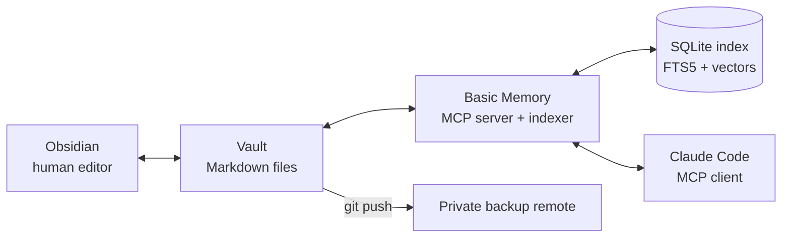

# Architecture

## Components

| Component | Runs as | Responsibility |
|---|---|---|
| Obsidian | Desktop app | Human editing, backlinks, graph view |
| Vault | Files on disk | Markdown + frontmatter + wiki-links; the only authoritative store |
| Basic Memory | Local process | Watches, indexes, searches, and exposes `bm_*` tools over MCP |
| SQLite index | `~/.basic-memory/memory.db` | Full-text rows, chunk embeddings, extracted relations |
| FastEmbed | In-process | Local `bge-small-en-v1.5` embeddings, 384 dimensions |
| Claude Code | MCP client | Reasons over retrieved notes and writes back under the vault's rules |
| Git remote | Private | Versioned backup; the index is reproducible and not backed up |

## Trust boundaries

- **One integration surface: the filesystem.** Obsidian and Basic Memory both read and write the same files. That is the whole sync mechanism.
- **MCP is the only agent boundary.** Claude reaches the vault solely through Basic Memory's tools over stdio; no network port is opened.
- **Local by default.** Embeddings are computed on-device. Notes leave the machine only when you push to a remote.
- **Writes are guarded.** Overwrite requires an explicit flag; deletion is disabled by default.

## Read path

1. Claude calls `bm_search`.
2. Basic Memory runs full-text and vector search, then fuses the rankings.
3. The optional cross-encoder reranker rescores the top candidates.
4. Claude reads hits with `bm_read` and walks relations with `bm_context`.
5. The answer cites `[[note titles]]`.

## Write path

1. Claude creates a note with `bm_write` under `00-Inbox/Agent/`.
2. Existing notes change through `bm_edit`, with a diff and checksum guard.
3. The file watcher reindexes the change; Obsidian sees it immediately.
4. A human or a scheduled job commits and pushes.
